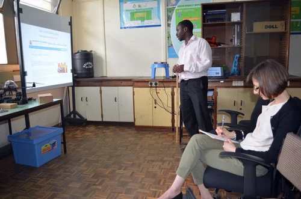
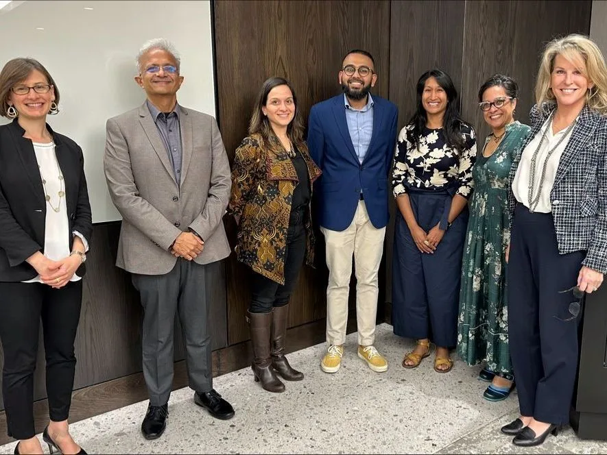
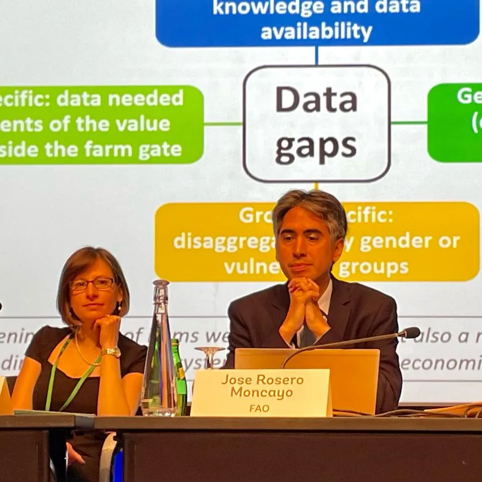
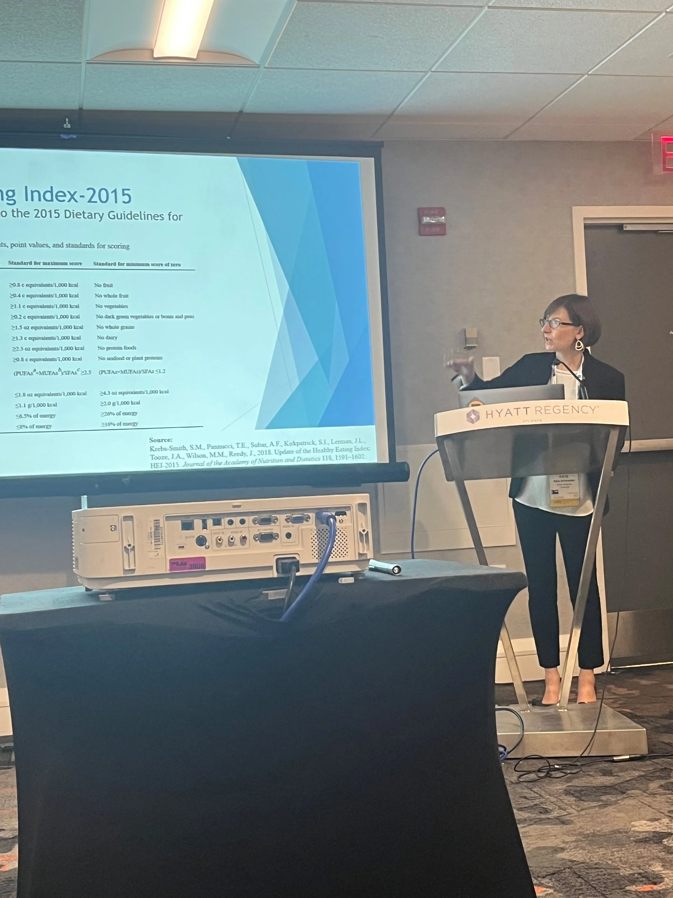
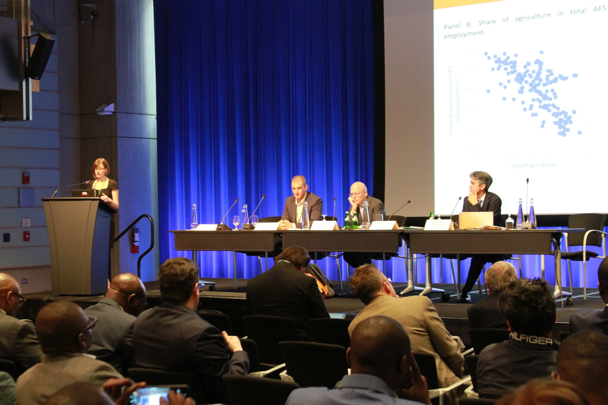
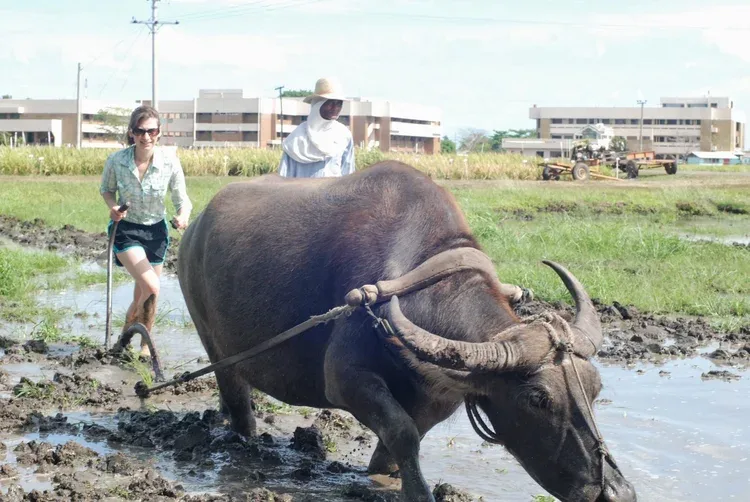

## Contact

**Email:** k.schneider.lecy [at] asu [dot] edu

School of Sustainability, Arizona State University
Tempe, AZ

## Find me elsewhere

- [Google Scholar](https://scholar.google.com/citations?hl=en&user=lWGTfD4AAAAJ) — full publication list and citation metrics
- [GitHub](https://github.com/KateSchneider-FoodPol) — data and replication code for published work
- [Harvard Dataverse](https://dataverse.harvard.edu/dataverse/Kate_Schneider) — archived research data
- [ORCID](https://orcid.org/0000-0002-6861-3255)
- [LinkedIn](https://www.linkedin.com/in/kate-schneider-7b9aaa26/)

```{=html}
<div class="photo-grid">
  
  
  
  
  
  
</div>
```
