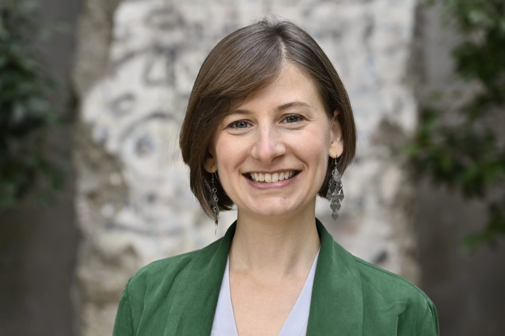
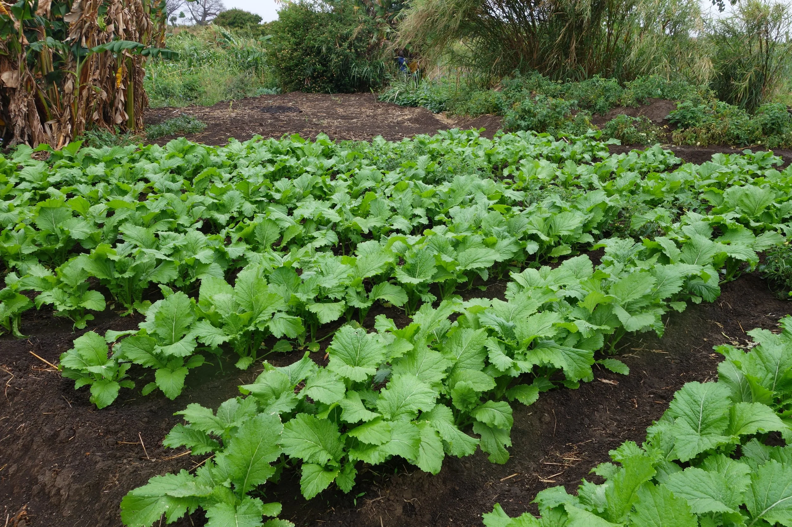

::: {.hero .hero-with-photo}
::: {.hero-text}
# Kate Schneider Lecy, PhD MPA

**Studying the policy and economics of food and nutrition across the globe** — in service of a world where everyone has access to enough healthy food from sustainable, ethical, and equitable food systems.

I am an applied economist and public health nutritionist working on healthy food access, equitable and sustainable food systems, and poverty reduction and prosperity, especially for the world's food producers.

**Assistant Professor** · School of Sustainability, College of Global Futures · Arizona State University
:::

{.hero-photo}
:::

{.banner-photo fig-alt="Fieldwork photo"}

I hold a PhD in Food Policy and Applied Nutrition from the Friedman School of Nutrition Science and Policy at Tufts University. Before joining ASU, I was a Research Scholar at the School of Advanced International Studies (SAIS) at Johns Hopkins University. Earlier in my career I spent five years at the Bill & Melinda Gates Foundation working on agricultural development, and I hold an MPA from the Evans School of Public Policy & Governance at the University of Washington and a BA in Sociology from McGill University.

My work has been published in top journals of applied economics (*Food Policy*, *American Journal of Agricultural Economics*), multidisciplinary food journals (*Nature Food*, *Global Food Security*), and public health (*The Lancet*, *Public Health Nutrition*), among others, and has been supported by funding from the Dutch Ministry of Foreign Affairs, the Robert Wood Johnson Foundation, the Food and Agriculture Organization of the United Nations, and the International Maize and Wheat Improvement Center, among others.

### Learn more

- **[Research](research.qmd)** — my research themes, ongoing projects, and collaborations
- **[Publications](publications.qmd)** — peer-reviewed articles, book chapters, and working papers, linked to data and replication code
- **[Teaching](teaching.qmd)** — courses, curriculum development, and student mentorship
- **[Impact](impact.qmd)** — how this work reaches policy, practice, and the public
- **[Contact & Links](contact.qmd)** — get in touch, and find me elsewhere online
- **[CV](cv.qmd)** — full academic CV
