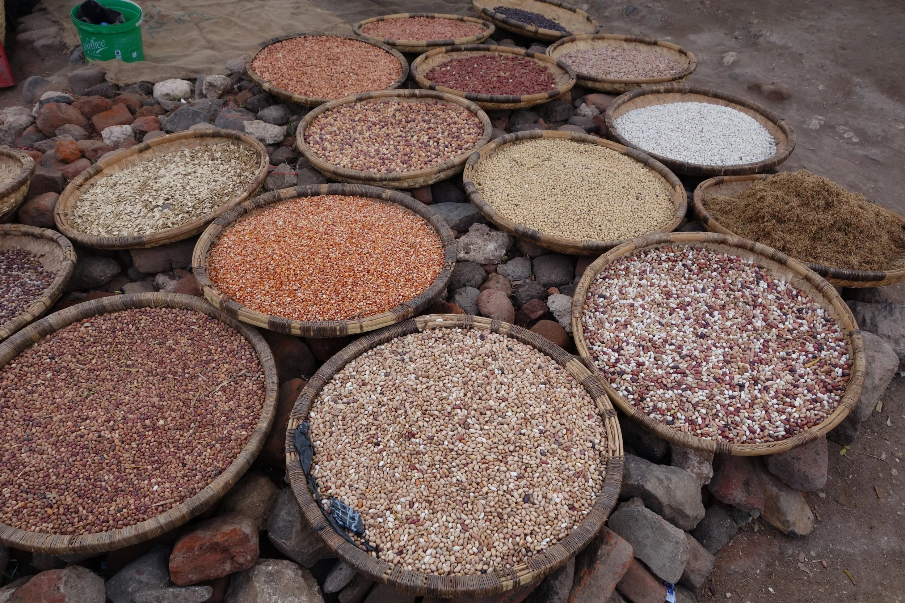
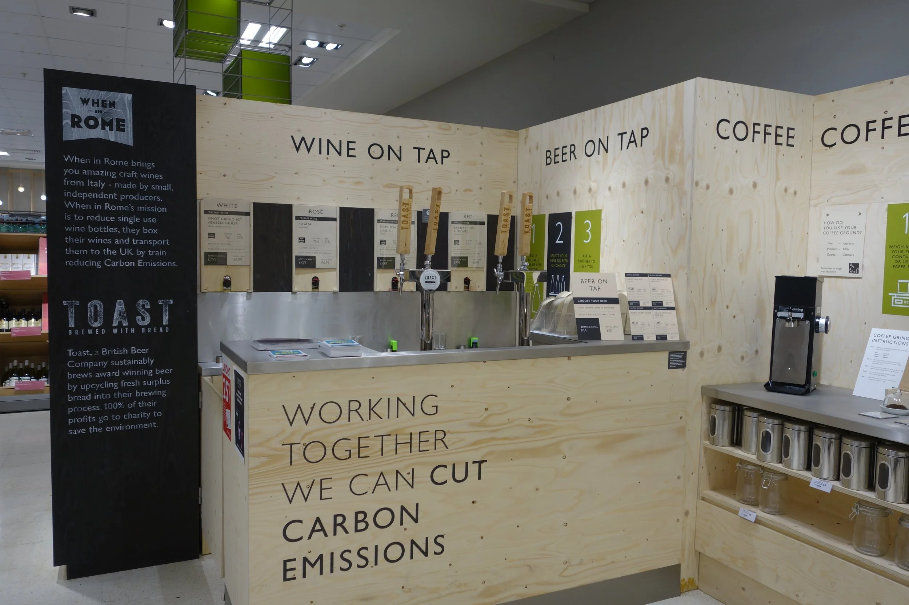
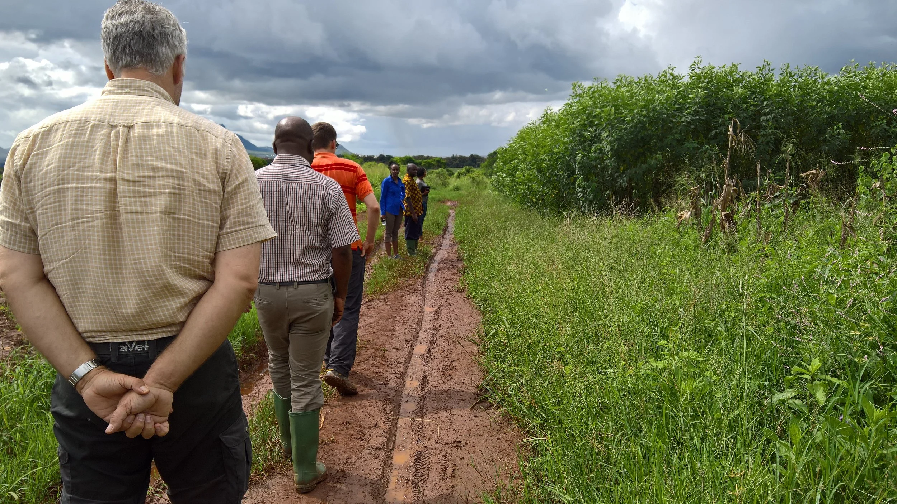

My research is grounded in the theory and methods of applied economics, public health nutrition, and data science, and asks one broad question: **how do we get from the food systems we have today to food systems — across scales — that are environmentally sustainable, resilient, healthy, equitable, provide for prosperous livelihoods, and are just?**

I work in interdisciplinary collaborations to answer specific questions that contribute to this vision, using detailed empirical analysis of primary and secondary, quantitative and qualitative data across the US, low-income countries (primarily sub-Saharan Africa and South Asia), and globally. That work sits within two related, overarching themes:

1. **Equitable access to and consumption of healthy and sustainable diets** — including increasing production and consumption of whole grains, legumes, and other "opportunity crops" through demand modeling, price analysis, choice experiments, and survey data analysis.
2. **Agrifood system transformation toward sustainability** — split into two connected bodies of work: monitoring and understanding food systems transformation at global and national scales, and filling data gaps in the economics of agrifood systems that these transformations depend on.

Each theme page below covers ongoing and completed projects and links to the publications that came out of them; the full [publications list](publications.qmd) is tagged back to these same themes.

::: {.theme-grid}
::: {.theme-card}
{.theme-card-photo fig-alt="Equitable access to healthy diets fieldwork"}

### [Equitable Access to Healthy & Sustainable Diets](research-equitable-access.qmd)

Understanding the constraints to accessing and choosing safe, nourishing, and satisfying foods that promote health and support well-being — in the US, Rwanda, Malawi, and beyond.

**[Read more →](research-equitable-access.qmd)**
:::

::: {.theme-card}
{.theme-card-photo style="object-position: center bottom;" fig-alt="Food systems transformation fieldwork"}

### [Food Systems Transformation](research-food-systems-transformation.qmd)

Monitoring and understanding historical and ongoing food systems change, and building policy-relevant food systems information systems and decision-support — including leading the data and analysis for the Food Systems Countdown Initiative.

**[Read more →](research-food-systems-transformation.qmd)**
:::

::: {.theme-card}
{.theme-card-photo fig-alt="Economics of agrifood systems fieldwork"}

### [Economics of Agrifood Systems](research-economics-data-gaps.qmd)

Filling data gaps in the economics of agrifood systems as the field shifts from a narrow focus on agriculture to an expanded view of the whole agrifood system — employment and value added.

**[Read more →](research-economics-data-gaps.qmd)**
:::
:::
